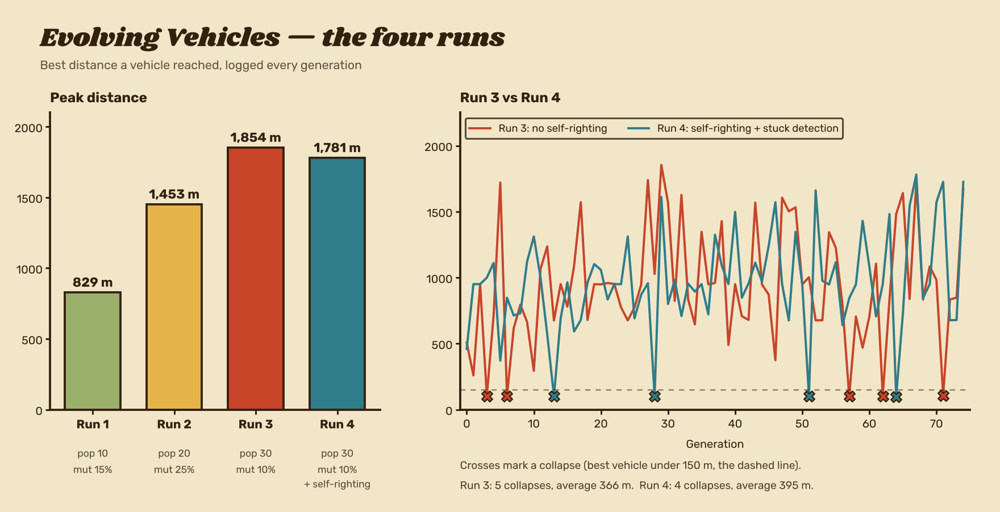

# Evolving Vehicles

A genetic algorithm in Unity that teaches cars to drive a hill-climbing course, built for my CMP304 Artificial Intelligence assessment at Abertay University (2025).

## How it works

- **Perception.** Every physics frame, each car reads its situation as one of **96 states**: six slope bands (steep downhill to steep uphill), four speed bands and four fuel levels (`slope * 16 + velocity * 4 + fuel`).
- **DNA.** Each car carries **192 genes**: an acceleration choice (none, slow, fast) and a rotation/lean choice for every one of the 96 states. Driving is a direct lookup from state to action.
- **Fitness.** Rewards distance (50 points per metre), checkpoints every 50 m and fuel efficiency, with a large bonus for finishing the 3,000 m course. Head collisions and getting stuck are penalised.
- **Evolution.** The top 20–30% survive as elites. The rest of the population is bred by tournament selection (best of 5), single-point crossover and per-gene mutation.
- **Stability fixes.** Stuck detection ends and penalises cars that stop making progress, and a gentle self-righting torque above 45° of tilt reduces the worst physics failures without driving for the AI.

## Results

| Run | Population | Mutation | Generations | Self-righting | Peak distance |
|-----|-----------|----------|-------------|---------------|---------------|
| 1 | 10 | 15% | 30 | No | 829 m |
| 2 | 20 | 25% | 50 | No | 1,453 m |
| 3 | 30 | 10% | 75 | No | **1,854 m** |
| 4 | 30 | 10% | 75 | Yes | 1,781 m |

Population size had the biggest effect on peak distance. Every run suffered collapses, where a nose-diving car wedged into the terrain kept a good score and passed its genes on. Adding stuck detection and self-righting in Run 4 cut collapses from 5 to 4 and raised the average population distance from 366 m to 395 m.

The per-generation logs for each run are in `Assets/GA_Logs/`.

## Running it

1. Open the project in **Unity VERSION_HERE** (see `ProjectSettings/ProjectVersion.txt`).
2. Open the main scene in `Assets/Scenes/`.
3. Press Play. Training starts with the settings on the `GA_Manager` object in the Inspector (population size, mutation rate, elite percentage, generation time).
## Key scripts

| Script | Role |
|--------|------|
| `VehicleDNA.cs` | The genome: 192 genes, crossover and mutation |
| `VehicleGameState.cs` | Turns slope, speed and fuel into a state index (0–95) |
| `AIVehicleController.cs` | Each car's brain: reads state, looks up DNA, records performance |
| `GeneticAlgorithmManager.cs` | Runs generations, fitness, elitism and tournament selection |
| `GADataLoggers.cs` | Writes per-generation stats to CSV |
| `EnvironmentGen.cs` | Procedural hills with Perlin noise and splines |

## Credits

- Inspired by *Hill Climb Racing* by Fingersoft.
- Base driving game adapted from a [Sasquatch B Studios tutorial](https://www.youtube.com/watch?v=E8lR59Yb2A0). The genetic algorithm, AI controller, state system, fitness, logging and stability systems are my own.

Portfolio: [ethantmccaffrey.github.io](https://ethantmccaffrey.github.io)
